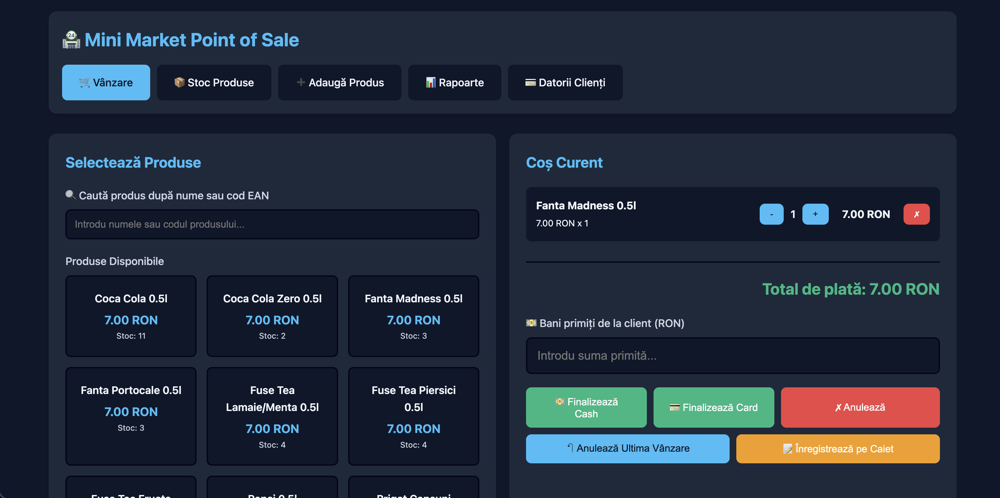
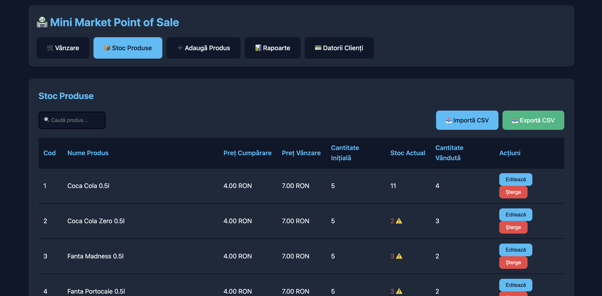
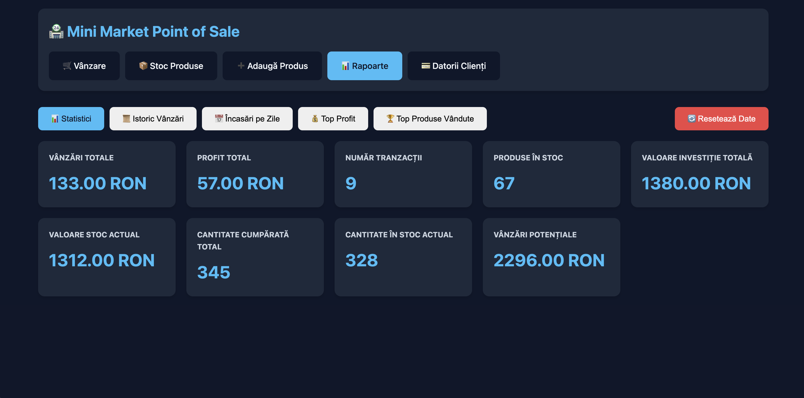

# 🏪 Mini POS Market


> A lightweight, fully offline Point of Sale system for small shops and kiosks.  
> Single HTML file — open in browser and start selling. No install, no server, no internet.

---

## 📋 Table of Contents

- [Features](#-features)
- [Quick Start](#-quick-start)
- [Screenshots](#-screenshots)
- [Tech Stack](#-tech-stack)
- [CSV Import Format](#-csv-import-format)
- [Deployment](#-deployment)
- [License](#-license)

---

## ✨ Features

<details>
<summary><strong>🛒 Sales</strong></summary>

- Split-screen layout: product grid (left) + cart (right)
- Search by product name or EAN barcode
- **Cash** & **Card** payment with automatic change calculator
- Credit sales (*"pe caiet"*) linked to a customer name
- Undo last sale — including debt payments

</details>

<details>
<summary><strong>📦 Inventory</strong></summary>

- Full product management: add, edit, delete
- Editable product code and initial stock quantity
- Low stock warning (⚠️ highlighted under 10 units)
- Sortable columns — click any table header
- Bulk import & export via CSV

</details>

<details>
<summary><strong>📊 Reports</strong></summary>

- Statistics: total sales, profit, investment value, potential revenue
- Separate totals for **Cash** and **Card** income
- Sales history with payment type per transaction
- Daily revenue breakdown (cash / card / credit per day)
- Top products by profit and by quantity sold
- One-click CSV export for every report tab

</details>

<details>
<summary><strong>💳 Customer Debts</strong></summary>

- Track unpaid (credit) sales per customer
- Record partial or full payments (cash or card)
- Summary row: total debt / total paid / total remaining
- Full debt history with paid date
- Undo payment — restores debt to active state

</details>

---

## 🚀 Quick Start

```bash
# Option A — just download and open
open index.html

# Option B — clone and open
git clone https://github.com/YOUR_USERNAME/mini-pos-market.git
cd mini-pos-market
open index.html
```

> No `npm install`. No `pip install`. No config. Just open the file.

---

## 📸 Screenshots

| 🛒 Sales | 📦 Inventory | 📊 Reports |
|:---:|:---:|:---:|
|  |  |  |

---

## 🧰 Tech Stack

| Layer | Technology |
|---|---|
| Structure | HTML5 |
| Styling | CSS3 — Variables, Grid, Flexbox |
| Logic | Vanilla JavaScript (ES6+) |
| Persistence | Browser `localStorage` |
| Export | `Blob` API → `.csv` download |
| Theming | `prefers-color-scheme` (auto dark/light) |

Zero external libraries. Zero build tools. Zero backend.

---

## 📥 CSV Import Format

```csv
Cod,Nume,Preț Cumpărare,Preț Vânzare,Cantitate Inițială,Stoc Actual,Cantitate Vândută,Total Cost,Total Cantitate
P001,Coca Cola 0.5L,3.50,7.00,100,100,0,0,0
```

> If `Total Cost` / `Total Cantitate` are `0`, the app auto-calculates them on import.

---

## 🚀 Deployment

See [DEPLOYMENT.md](docs/DEPLOYMENT.md) for full instructions including:
- Local file usage
- GitHub Pages
- Netlify / Vercel
- Nginx self-host
- Chrome Kiosk mode for dedicated shop terminals

---

## 🤝 Contributing

See [CONTRIBUTING.md](docs/CONTRIBUTING.md) for guidelines.

---

## 📄 License

MIT © 2026 — see [LICENSE](LICENSE)
