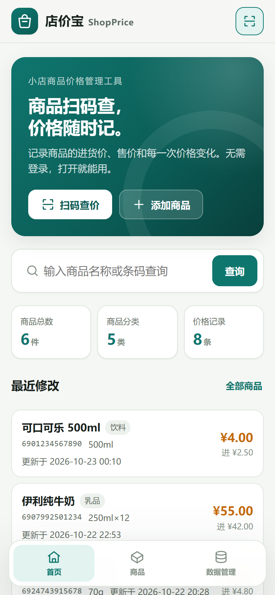
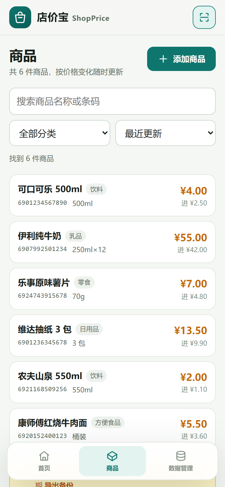
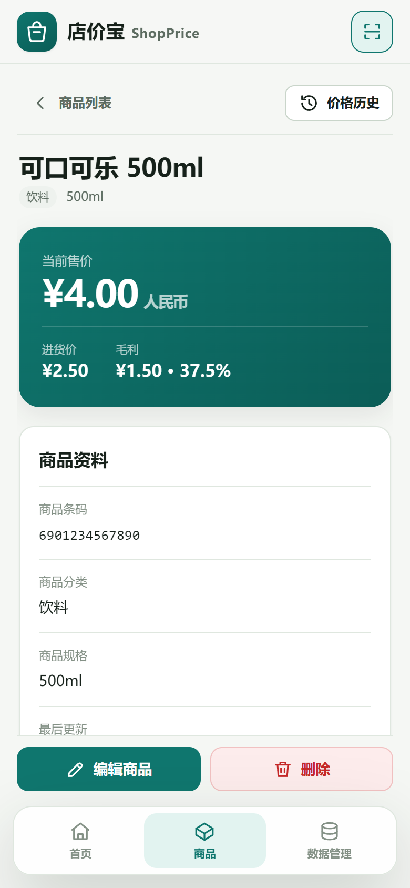
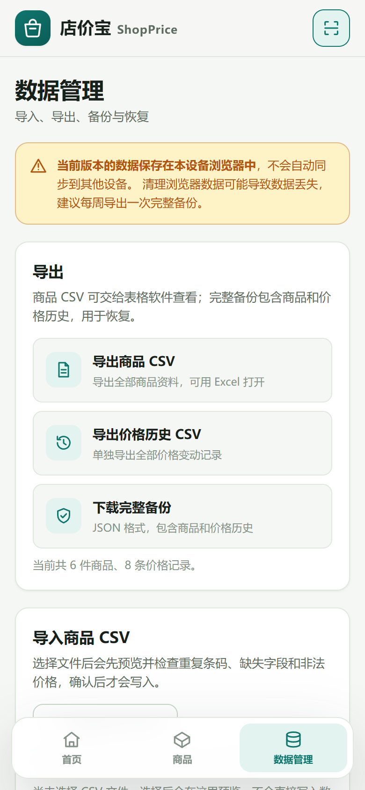

# 店价宝 ShopPrice


> **商品扫码查，价格随时记。**
>
> 店价宝是一款面向夫妻店、小超市、便利店和摊位的**商品价格管理工具**。
> 扫码或搜索即可查价，随手记录进货价、售价和每一次价格变化。
> 无需登录、无需服务器，打开浏览器就能用，数据只保存在本机。

---

## 目录

- [功能](#功能)
- [界面预览](#界面预览)
- [快速开始](#快速开始)
- [使用说明](#使用说明)
- [CSV 格式](#csv-格式)
- [备份与恢复](#备份与恢复)
- [数据与隐私](#数据与隐私)
- [技术栈与目录](#技术栈与目录)
- [部署](#部署)
- [测试](#测试)
- [已知限制](#已知限制)
- [许可与来源](#许可与来源)

---

## 功能

### 扫码查价

- 调用设备摄像头扫描商品条码，识别后直接打开商品详情。
- 条码不存在时，自动进入新增商品页并填入条码，避免重复输入。
- 摄像头不可用（无权限、非 HTTPS、无摄像头）时，始终可以手动输入条码查询。
- **只识别条码，不联网获取商品名称或市场售价**，所有资料由店主自行录入。

### 商品管理

- 新增、查看、编辑、删除商品。
- 字段：商品名称、商品条码（可选，非空时唯一）、规格、分类、进货价、售价、备注、创建时间、更新时间。
- 商品名称与两项价格必填，价格必须为不小于 0 的有效数字。
- 编辑页停止输入约 0.6 秒后**自动保存**；切换页面或关闭页面前也会尝试保存，刷新后数据仍在。
- 删除需要两次确认，并可明确选择是否同时删除该商品的价格历史。

### 价格历史

- 新增商品时自动记录一条“初始”价格。
- 只有**进货价或售价发生变化**时才新增记录，记录修改前和修改后的两项价格。
- 修改名称、规格、分类、备注不会产生价格记录。
- 每条记录标明来源：初始、编辑、CSV 导入、旧版迁移；恢复备份时保留原来源。
- 商品详情页按时间倒序展示历史，可单独导出价格历史 CSV。

### 查询与筛选

- 按商品名称或条码模糊搜索。
- 按分类筛选。
- 支持按最近更新、名称、售价从低到高、售价从高到低排序。
- 首页展示商品总数、分类数、价格记录数和最近修改的商品。

### 数据管理

- 导出全部商品 CSV（Excel 可直接打开）。
- 导出价格历史 CSV。
- 导入商品 CSV：先预览，再确认写入；默认跳过已存在条码，也可明确选择“按条码更新”。
- 下载完整 JSON 备份（商品 + 价格历史）。
- 恢复备份：默认**合并**并跳过冲突，覆盖恢复需要二次确认，可先自动下载当前数据。
- 清空本机数据前可选择自动下载备份。

### 其他

- 中文界面，移动端优先，底部导航：首页 / 商品 / 数据管理。
- 自适应浅色/深色主题，支持键盘操作和基础无障碍标签。
- 自动识别旧版 Mini POS Market 的 `localStorage` 商品数据，一次性迁移且**不删除原始数据**。
- 无账号、无云同步、无广告、无付费接口、无构建步骤；扫码库已本地化，运行时不请求外部网络。

### 明确不做

店价宝不是收银系统，不包含：结账/购物车、挂账与欠款、库存数量与进货、会员积分、市场价查询、云端同步、AI 定价、订阅付费。请按“价格记录本”的定位使用。

---

## 界面预览

| 首页 | 商品列表 |
|:---:|:---:|
|  |  |

| 商品详情 | 数据管理 |
|:---:|:---:|
|  |  |

---

## 快速开始

### 方式一：直接打开

下载或克隆项目后，双击 `index.html`，用最新版 Chrome、Edge、Firefox 或 Safari 打开即可。

> 直接以 `file://` 打开时，商品管理和数据导入导出均可使用；但浏览器通常**不会开放摄像头**。需要扫码时请使用方式二或部署到 HTTPS。

### 方式二：本地服务器（推荐）

在项目目录执行任意一种：

```bash
# Python 3
python -m http.server 8123

# 或 Node.js
npx serve .
```

然后访问 <http://localhost:8123/>。`localhost` 属于安全上下文，可以使用摄像头扫码。

用手机在同一局域网测试时，可执行：

```bash
python -m http.server 8123 --bind 0.0.0.0
```

手机访问 `http://电脑IP:8123/` 可以浏览和管理数据，但**摄像头扫码通常需要 HTTPS**。正式使用请部署到 HTTPS 静态站点，或用 Caddy/Nginx 配置本地证书，详见 [DEPLOYMENT.md](DEPLOYMENT.md)。

### 系统要求

- 现代浏览器（Chrome / Edge / Firefox / Safari 最近两个大版本）。
- 启用 JavaScript 和 `localStorage`。
- 扫码需要摄像头、浏览器权限和安全上下文（`https://` 或 `localhost`）。
- 不需要 Node.js、npm、数据库或任何后端服务。

---

## 使用说明

### 添加商品

1. 点击首页“添加商品”或商品页右上角“添加商品”。
2. 填写商品名称、进货价、售价；条码、规格、分类、备注可选。
3. 点击“保存商品”。保存后会进入详情页，并自动生成初始价格记录。

### 编辑与自动保存

- 在详情页点击“编辑”，修改后停止输入约 0.6 秒即自动保存。
- 表单下方会显示“已自动保存 时间”；价格变化时会提示已记录价格变动。
- 若填写有误，自动保存会暂停并提示具体字段，修正后继续。
- 修改价格会写入历史；只改名称、规格、分类或备注不会写入历史。

### 扫码查价

1. 点击页头扫码按钮、首页“扫码查价”或新增页条码旁的扫码按钮。
2. 首次使用时允许浏览器访问摄像头。
3. 将条码对准取景框，识别成功后自动查询。
4. 已有商品进入详情；未知条码进入新增页并填入条码。
5. 无法扫码时，在弹窗下方手动输入条码后查询。

> 扫码结果只作为条码使用，不会联网补全商品名称，也不会显示所谓“市场价”。

### 价格历史规则

| 操作 | 是否新增记录 | 记录内容 |
|---|---|---|
| 新增商品 | 是 | 初始进货价、初始售价 |
| 修改进货价或售价 | 是 | 修改前后两项价格 |
| 只修改名称/规格/分类/备注 | 否 | — |
| CSV 更新已有商品且价格变化 | 是 | 修改前后两项价格，来源“CSV 导入” |
| CSV 新增商品 | 是 | 初始价格，来源“CSV 导入” |
| 合并恢复备份 | 否（保留备份自带历史） | 备份中的历史原样加入 |
| 覆盖恢复备份 | 否（整体替换） | 使用备份中的商品与历史 |
| 删除商品 | 由用户选择 | 默认保留历史，也可同时删除 |

价格历史独立于商品保存。删除商品时若选择保留历史，记录仍会出现在“价格记录”总数和导出的历史 CSV 中，并显示为已删除商品。

### 删除商品

1. 在详情页点击“删除”。
2. 弹窗会显示该商品的历史条数。
3. 勾选是否“同时删除价格历史”（默认不勾选，保留历史）。
4. 再勾选“我确认删除该商品”，点击确认。两次确认都完成才会删除。

---

## CSV 格式

### 商品 CSV

导出的表头如下，导入时也推荐使用同样格式：

```csv
商品名称,商品条码,商品规格,商品分类,进货价,售价,备注,创建时间,更新时间
可口可乐 500ml,6901234567890,500ml,饮料,2.50,4.00,冰柜常备,,
```

导入规则：

- 至少需要能识别出**商品名称、进货价、售价**三列。
- 支持常见中文别名（名称/品名、条码/编码、进价/成本价、售价/零售价等），也兼容旧版 `Cod,Nume,Preț Cumpărare,Preț Vânzare` 表头。
- 自动识别逗号、分号或制表符分隔；支持带引号字段和 UTF-8 BOM（Excel 中文不乱码）。
- 条码可留空；非空条码不能与现有商品或其他导入行重复。
- 价格必须为非负数；缺失名称、非法价格、重复条码会在预览中标记。
- 默认模式“跳过已存在条码”；选择“按条码更新”后才覆盖已有商品资料，价格变化会写入历史。
- 单次最多 5000 行、文件最大 5 MB。
- 旧版文件中的库存、销量、销售额等字段会被忽略；文件尾部旧版销售历史会被跳过。
- 导入前一定会显示预览和统计，确认后才写入；不会静默覆盖。

### 价格历史 CSV

```csv
商品ID,商品名称,修改前进货价,修改后进货价,修改前售价,修改后售价,修改时间,来源
```

价格历史 CSV 用于查看和归档，目前不参与导入。恢复历史请使用完整 JSON 备份。

---

## 备份与恢复

- **完整备份**是 JSON 文件，包含商品、价格历史和元数据，推荐每周下载一次。
- 恢复前会显示商品数、历史数、冲突数和无法读取的数据。
- **合并恢复（默认）**：只加入新商品；ID 或条码冲突的商品跳过，不覆盖现有资料。
- **覆盖恢复**：用备份完全替换当前数据；需要额外勾选确认，并建议先自动下载当前备份。
- 无效 JSON、非店价宝备份、来自更高版本的备份都会被拒绝并提示原因。
- 备份中的非法商品（缺名称、负价格等）会跳过并列出原因，不影响其他有效数据。

> `localStorage` 按浏览器、按设备隔离，不会自动同步。清理浏览器数据、卸载浏览器、使用无痕模式或更换设备都可能看不到原数据。**CSV 不是完整备份，请定期下载 JSON 完整备份。**

---

## 数据与隐私

所有数据仅保存在当前浏览器的 `localStorage` 中：

| 键 | 内容 |
|---|---|
| `shopprice_products_v1` | 商品数组 |
| `shopprice_price_history_v1` | 价格历史数组 |
| `shopprice_meta_v1` | 初始化、迁移等元数据 |

- 无后端、无登录、无统计脚本、无第三方请求；随项目附带的扫码库也在本地加载。
- 商品资料不会上传到任何服务器。
- 数据未加密，能使用这台设备和浏览器的人即可查看。请为设备设置锁屏，并妥善保管备份文件。
- 清理站点数据前务必先下载完整备份。

旧版 Mini POS Market 的 `products`、`sales`、`debts`、`paidDebts` 键不会被删除；仅当新键尚不存在且旧商品数据有效时，才会执行一次迁移。

---

## 技术栈与目录

纯静态单页应用：HTML5 + CSS3 + 原生 JavaScript（ES6+）+ `localStorage`。无框架、无打包器、无运行时依赖、无后端。

```text
shopprice/
├─ index.html                 页面骨架、图标、脚本加载
├─ assets/
│  ├─ styles.css              响应式浅色/深色样式
│  ├─ js/
│  │  ├─ core.js              常量、工具、存储、迁移、弹窗与提示
│  │  ├─ views.js             页面与列表渲染
│  │  ├─ data-csv.js          CSV 解析、预览、导入、导出
│  │  ├─ data-backup.js       JSON 备份、恢复、清空
│  │  ├─ scanner.js           摄像头扫码与手动条码回退
│  │  └─ app.js               路由、表单校验、自动保存、事件、启动
│  ├─ screenshots/            README 截图
│  └─ vendor/
│     ├─ html5-qrcode.min.js  本地扫码库（Apache-2.0）
│     └─ html5-qrcode.LICENSE.txt
├─ backup/                    改造前原始文件备份（仅参考，不参与运行）
├─ docs/
│  ├─ CONTRIBUTING.md         贡献指南
│  └─ TESTING.md              测试说明与结果
├─ tests/e2e.js               Playwright 端到端测试（仅开发使用）
├─ package.json               测试脚本与 devDependency
├─ .nojekyll                  GitHub Pages 配置
├─ TECH.md                    架构与数据设计
├─ DEPLOYMENT.md              部署与 HTTPS 说明
├─ CHANGELOG.md               版本记录
└─ LICENSE                    MIT
```

更详细的数据结构、模块职责和边界条件见 [TECH.md](TECH.md)。

---

## 部署

这是纯静态站点，可部署到任意静态托管：

- **GitHub Pages**：仓库 Settings → Pages → Deploy from a branch → 选择分支和项目根目录。
- **Netlify**：把整个 `shopprice` 目录拖到 <https://app.netlify.com/drop>。
- **Vercel**：项目根目录执行 `vercel --prod`（无需构建命令）。
- **Nginx/Apache**：把目录作为站点根目录，`index.html` 为默认页。
- **平板/专卖设备**：浏览器“添加到主屏幕”或以应用窗口打开。

摄像头扫码必须通过 HTTPS 或 `localhost` 访问。完整步骤、HTTPS 配置、局域网测试和排错见 [DEPLOYMENT.md](DEPLOYMENT.md)。

---

## 测试

2026-10-23 使用 Chrome 无头模式在 390×844 移动视口完成 48 项端到端检查，全部通过，覆盖：

- 新增、校验、编辑自动保存、刷新持久化
- 初始价格与价格变动历史规则
- 搜索、分类筛选、排序
- 扫码手动回退、未知条码跳转新增
- CSV 导出、预览、导入、更新、重复条码、旧版格式
- JSON 备份、合并/覆盖恢复、无效文件
- 删除二次确认与历史保留/删除
- 移动端无横向溢出、清空数据、旧版数据迁移

复现步骤和结果见 [docs/TESTING.md](docs/TESTING.md)。测试依赖 Playwright（仅开发使用，不影响静态应用运行）；测试只覆盖手动条码回退，未在真实手机摄像头上做硬件识别测试。

---

## 已知限制

1. **数据不跨设备同步**：换手机、换浏览器或清理浏览器数据后，原数据不会自动出现，必须用 JSON 备份恢复。
2. **摄像头依赖环境**：必须是 HTTPS 或 localhost；需要用户授权；部分内置浏览器、旧设备或桌面摄像头对焦能力有限。扫码失败时请使用手动输入。
3. **条码识别率因设备而异**：扫码库会优先使用浏览器原生 `BarcodeDetector`，不支持时回退到 JS 解码；识别速度和对焦表现与摄像头、光线、条码清晰度有关。
4. **不联网补全商品信息**：不会根据条码获取商品名称、图片或市场价格。
5. **价格历史不能单条编辑或删除**：只随商品删除而清理；删除商品后保留的历史会成为孤立记录。
6. **单机单用户**：没有账号、权限、审计或多员工协作。
7. **容量限制**：CSV 单次最多 5000 行 / 5 MB；完整备份最大 25 MB；浏览器 `localStorage` 通常只有几 MB，商品很多时请定期清理或归档。
8. **货币显示固定为人民币 `¥`**：可识别常见货币符号输入，但界面不提供多币种切换。
9. **未加密**：本地数据对能访问该浏览器的人可见。
10. **无真实摄像头自动化测试**：当前测试环境为无头 Chrome，扫码流程仅验证了手动回退与跳转逻辑。

---

## 许可与来源

- 本项目采用 [MIT License](LICENSE)。
- 界面与初始架构参考 Mini POS Market（MIT）。原始文件保留在 `backup/` 目录，仅作来源说明，不参与运行。
- 条码扫描使用 [html5-qrcode](https://github.com/mebjas/html5-qrcode) 2.3.8，Apache-2.0，已本地化到 `assets/vendor/`，许可证见 `assets/vendor/html5-qrcode.LICENSE.txt`。
- MIT 允许商用、修改和再分发，但需保留版权与许可声明。发布时请同时保留本项目 `LICENSE` 和扫码库的 Apache-2.0 许可文本。

---

**店价宝 ShopPrice** · 商品扫码查，价格随时记。
